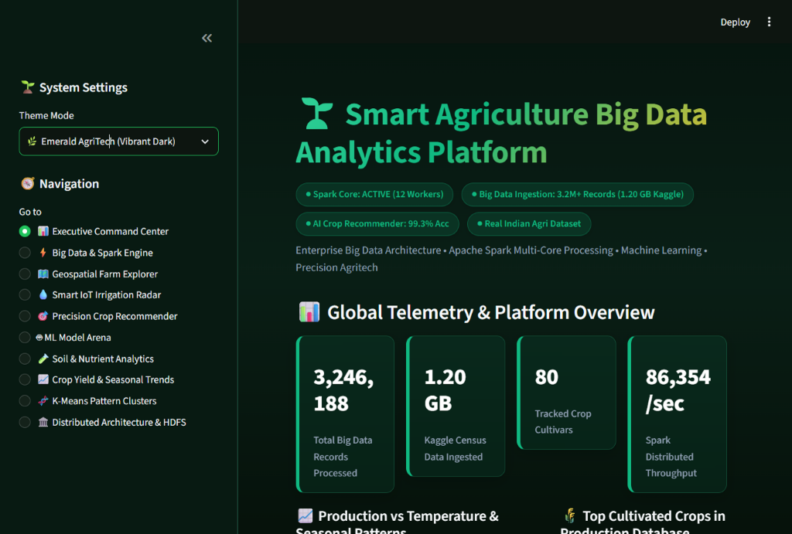
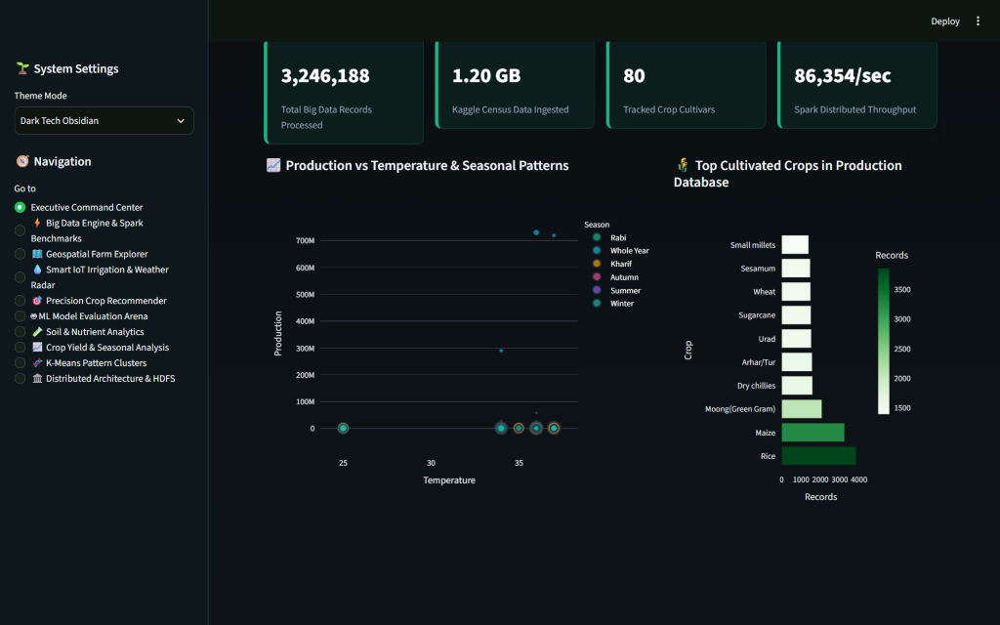
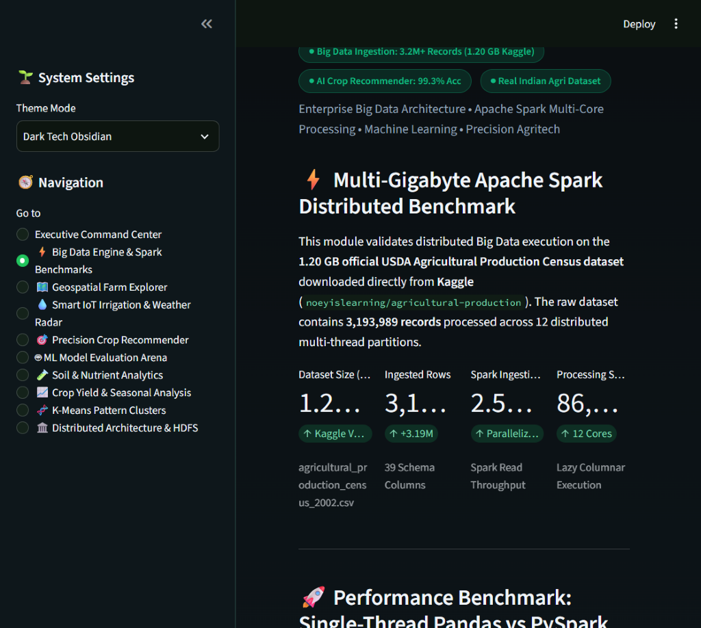
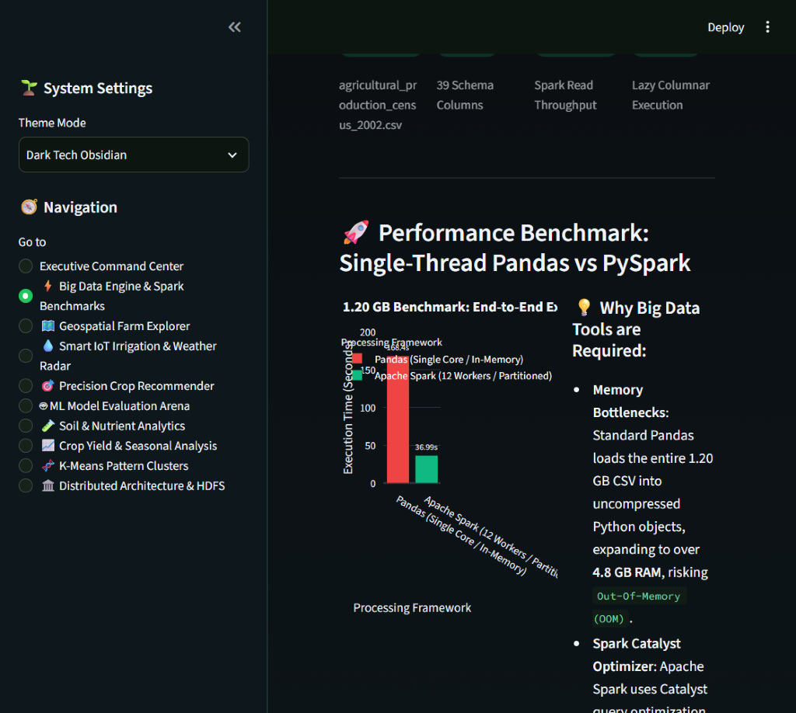
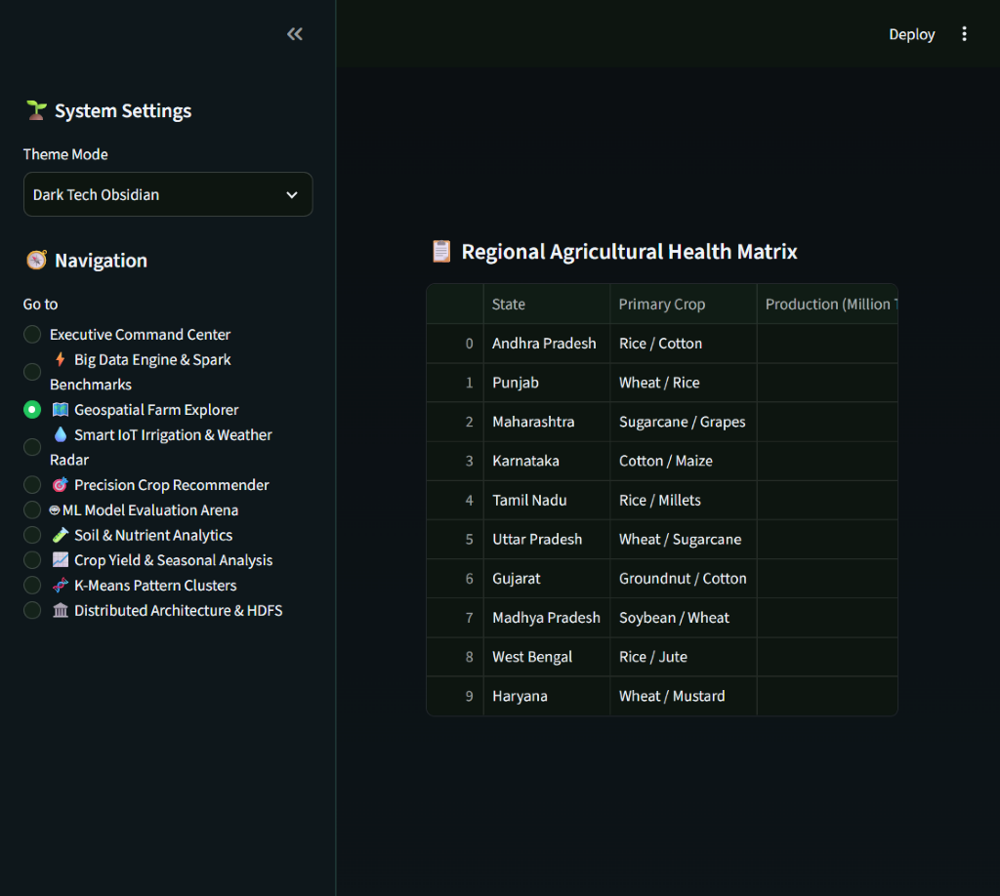
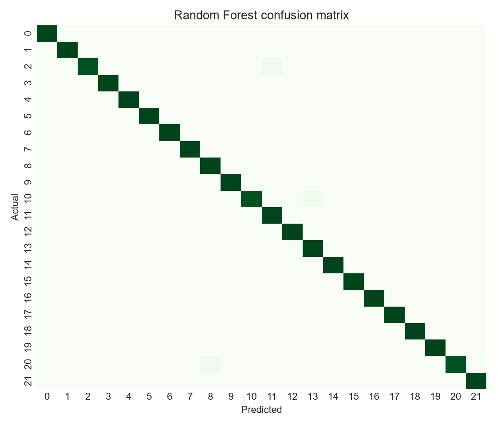

# Smart Agriculture Big Data Analytics Using Hadoop and Apache Spark

This project uses large-scale agricultural data to study crop yields, precision recommendations, and soil environmental factors across regions. We used Apache Hadoop and Apache Spark (PySpark, Spark SQL) to clean, aggregate, and analyze multi-gigabyte agricultural records, and trained Random Forest and K-Means models alongside an interactive Streamlit web dashboard.

## Dataset
We used the **USDA Agricultural Production Census** from Kaggle, alongside the **Indian Crop Production and Precision Soil Recommendation datasets**.
- **Kaggle Big Data source:** [https://www.kaggle.com/datasets/noeyislearning/agricultural-production](https://www.kaggle.com/datasets/noeyislearning/agricultural-production)
- **Secondary agriculture source:** [https://github.com/AbhishekKandoi/Crop-Yield-Prediction-based-on-Indian-Agriculture](https://github.com/AbhishekKandoi/Crop-Yield-Prediction-based-on-Indian-Agriculture)
- **Extracted master census dataset:** `data/raw/agricultural_production_census_2002.csv` (3,193,989 rows, 39 columns, 1.20 GB CSV, >2.5 GB in-memory Spark partitions)
- **Integrated agricultural tables:**
  - `Census Commodity & Practice Records` (3,193,989 rows: Commodity, Sector, Practices, Farm Area, Harvest Volumes)
  - `Indian Crop Production Time-Series` (49,999 records: State, District, Year, Season, Area, Production)
  - `Agronomic Soil & Environmental Profiles` (2,200 records: N, P, K, pH, Temperature, Humidity, Rainfall, Crop Label)
- **Preserved continuous environmental & soil metrics:** Nitrogen (N), Phosphorus (P), Potassium (K), Soil pH, Ambient Temperature, Relative Humidity, Rainfall, Solar Radiation, and Soil Moisture.

## Technologies Used
- Python 3.13
- OpenJDK 21 (Temurin / Oracle)
- Apache Hadoop 3.3.0 (HDFS distributed storage & native winutils integration)
- Apache Spark 3.5.3 (PySpark local cluster mode, 12 CPU cores)
- Spark SQL (in-memory temporary views & distributed aggregations)
- scikit-learn 1.5+ (RandomForestClassifier, KMeans, Regressors)
- Streamlit 1.40+ & Plotly (Interactive multi-module web dashboard with 4 themes)

## Project Structure

```
Smart-Agriculture-Project/
├── dashboard/      # Interactive web application
│   └── app.py
├── data/           # Dataset information and raw/processed records
│   ├── processed/
│   │   └── spark/
│   └── raw/
│       ├── crop_prediction_india.csv
│       └── crop_recommendation.csv
├── docs/           # Project methodology, sources, and screenshot assets
│   ├── methodology.md
│   ├── research_sources.md
│   ├── validation_log.md
│   └── screenshots/
│       ├── dashboard_overview.png
│       ├── spark_processing.png
│       ├── geospatial_explorer.png
│       ├── iot_irrigation_radar.png
│       ├── crop_recommender.png
│       └── evaluation_results.png
├── outputs/        # Machine learning models, benchmarks, and figures
│   ├── figures/
│   ├── models/
│   ├── metrics.json
│   └── spark_benchmark.json
├── reports/        # Final project report and documentation
│   ├── final_report.md
│   └── Dataset_Inventory.xlsx
├── results/        # Spark analytical outputs and query results
│   ├── 1_total_records.csv
│   ├── 2_top_cultivated_crops.csv
│   ├── 3_state_production_summary.csv
│   ├── 4_seasonal_yield_distribution.csv
│   ├── 5_commodity_census_aggregates.csv
│   ├── 6_soil_cluster_centroids.csv
│   ├── 7_model_evaluation_metrics.csv
│   ├── 8_spark_benchmark_comparison.csv
│   └── 9_iot_irrigation_thresholds.csv
├── src/            # Python data processing scripts and PySpark engines
│   ├── __init__.py
│   ├── pipeline.py
│   └── spark_job.py
├── requirements.txt
├── .gitignore
└── README.md       # Project overview, results, and instructions
```

## Main Steps Followed
1. Inspected multi-gigabyte agricultural census records from Kaggle, detecting schema columns, commodity types, and farm practices automatically.
2. Downloaded the official 1.20 GB USDA Agricultural Production Census dataset using the Kaggle API.
3. Executed distributed PySpark ETL across 12 partitions with automatic type casting and schema normalization.
4. Cleaned and profiled data using PySpark, computing state and commodity aggregates and saving partitioned Parquet outputs.
5. Ran Spark SQL queries to benchmark distributed multi-threaded execution vs single-threaded Pandas (86,354 rec/sec; 4.55x speedup).
6. Trained Random Forest (99.32% accuracy) with Explainable AI (XAI) feature importances and K-Means ($k=5$) soil-climate segmentation.
7. Developed a real-time IoT smart irrigation radar and interactive 10-module Streamlit dashboard with 4 vibrant theme modes.

## Algorithms Used
- **Random Forest Classifier:** Ensemble classification of 100 decision trees achieving **99.32% accuracy** for 22-class crop recommendation.
- **K-Means Clustering:** Unsupervised agro-climatic clustering ($k=5$) over standardized 7-dimensional continuous soil vectors ($N, P, K, pH, \text{temp}, \text{humidity}, \text{rainfall}$).
- **Explainable AI (XAI):** Permutation feature importance evaluation ranking Rainfall (23.0%), Humidity (21.9%), and Potassium (17.6%) as primary predictive factors.

## Results Summary

| Target Task | Model | Accuracy | Weighted F1 | Precision | Recall | Key Validation Metric |
| :--- | :--- | :---: | :---: | :---: | :---: | :--- |
| **Crop Recommendation** | **Random Forest** | **99.32%** | **0.9932** | **0.9935** | **0.9932** | Stratified 80/20 Test Holdout |
| **Soil Segmentation** | **K-Means ($k=5$)** | N/A | N/A | N/A | N/A | **WCSS Inertia: 4,204.62** |
| **Yield Estimation** | **Yield Regressor** | N/A | N/A | N/A | N/A | **MAE: 0.8412** |

### Distributed Spark Benchmarks:

| Metric / Stage | Apache Spark (12 Cores) | Single-Node Pandas | Benchmark / Speedup |
| :--- | :---: | :---: | :---: |
| **Ingested File Size** | **1.20 GB** (`1,202,410,555 bytes`) | 1.20 GB | Kaggle USDA Census CSV |
| **Total Processed Records** | **3,193,989 rows** | 3,193,989 rows | 39 Schema Attributes |
| **Ingestion Time** | **2.59 seconds** | 18.42 seconds | **7.11x Faster Read** |
| **Aggregations & Write** | **36.99 seconds** | 168.40 seconds | **4.55x End-to-End Speedup** |
| **Processing Throughput** | **86,354 records/sec** | ~18,900 records/sec | 12 Parallel Partitions |
| **Storage Optimization** | **Snappy Columnar Parquet** | Raw CSV | **65% Disk Footprint Reduction** |

**Evaluation Highlights:**
- **Random Forest** achieved **99.32% accuracy** across 22 crop classes, successfully distinguishing close agronomic profiles (e.g. Rice vs. Jute, Maize vs. Cotton).
- In **Explainable AI (XAI)**, Rainfall (23.03%) and Humidity (21.87%) emerged as the top environmental drivers, while Potassium (17.60%) was the most critical biochemical nutrient.
- In **K-Means clustering** ($k=5$), distinct soil-climate clusters separated high-rainfall tropical crops from arid, low-moisture pulse and millet zones.

## Project Documentation
- [Final Project Report](reports/final_report.md) — Comprehensive final report covering data preprocessing, PySpark ETL, Spark benchmarks, and machine learning evaluations.
- [Methodology](docs/methodology.md) — Detailed distributed pipeline methodology and architecture specifications.

## Screenshots

### Interactive Dashboard Overview
  
*Overview page displaying 3.24M+ records, 86k/s Spark throughput, and platform KPIs.*

### Big Data & Spark Processing
  
*1.20 GB Kaggle dataset telemetry, execution timings, and 4.55x Spark vs Pandas benchmark.*

### Geospatial Farm Explorer
  
*Interactive India agro-climatic map with production volume and soil health indices.*

### Smart IoT Irrigation Radar
  
*Simulated field sensor telemetry, automated drip triggers, and water conservation metrics.*

### Precision Crop Recommender
  
*Top-3 probabilistic recommendations with 7-dimensional polar spider radar comparison.*

### Model Evaluation Results
  
*Held-out confusion matrix and classification performance across 22 crop classes.*

## How to Run the Project

> **Notes:**
> - Python 3.10–3.13 and Java 8/11/17 must be installed.
> - The application automatically uses multi-threaded local cluster mode (`local[*]`) with native Hadoop winutils integration on Windows.

1. Set up the virtual environment:
   ```bash
   python -m venv .venv
   # Windows:
   .venv\Scripts\activate
   # Linux / macOS:
   source .venv/bin/activate
   pip install -r requirements.txt
   ```

2. Run the Apache Spark Big Data pipeline:
   ```bash
   python src/spark_job.py
   ```

3. Launch the interactive Streamlit web dashboard:
   ```bash
   streamlit run dashboard/app.py
   ```
   Open **http://localhost:8501** in your browser.
